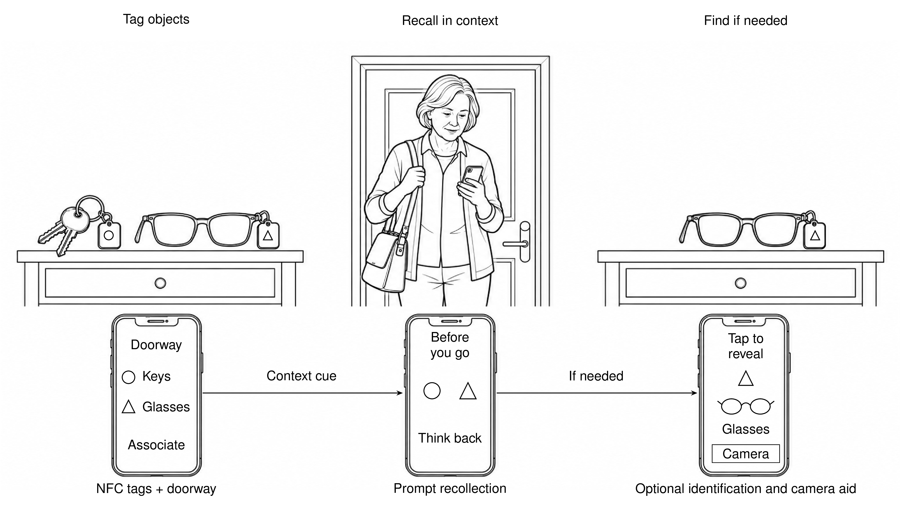

# SnapTag: Leveraging Situated Memory to enhance self-efficacy for well-being

**Suraj Baadkar, Gaurav Singh, Atul Saraf and Naveen Bagalkot**

Srishti Labs, Srishti School of Art, Design and Technology, Bangalore, India.

Published in the proceedings of **India HCI 2014**, Association for Computing
Machinery (ACM), pages 136–141.

[Read the paper](https://doi.org/10.1145/2676702.2676719)



The belongings scenario illustrates the proposed interaction. Shape cues represent
the paper's tag cues in monochrome; the screens are schematic.

[Figure sources, generation history and build instructions](figures/snaptag/README.md).

## Abstract

Research shows that inherent psychological barriers linked to memory loss shape ageing people’s self-efficacy to perform tasks of everyday living. In this paper we present SnapTag, a design concept for a mobile application that leverages situated memory to enhance self-efficacy in senior citizens for their wellbeing. SnapTag aims to trigger a recollection of situated memory in senior citizens through micro-interactions. We speculate that such triggering encourages senior citizens to approach their daily activities with a sense of efficacy and confidence. We expect that our exploration to point the interaction design and HCI communities to further research and develop to explore the situated aspects of memory recall while designing for senior wellbeing.

## The idea

Forgetting an everyday object or becoming unsure about a routine can affect a
person's confidence as well as their ability to complete a task. SnapTag explores
how a mobile application could support older adults by prompting them to recall
information through cues connected to objects, places and activities.

The design draws on **situated memory**: recalling information through its
context. Its aim is to support **self-efficacy**, a person's confidence in their
ability to carry out everyday tasks.

## How SnapTag works

The proposed interaction has three stages:

| Tag | Recall | Find |
| --- | --- | --- |
| Associate important objects with NFC tags, and connect places or pictures to situations and times. | Use contextual prompts to encourage recollection before directly supplying the information. | Offer a fallback for identifying or locating an object when more help is needed. |

The paper develops two everyday scenarios: remembering belongings when leaving
home, and recognizing medicines and their associated routines.

## Research and contribution

The design was informed by interviews, routine mapping and shadowing with five
adults aged 58–70 in suburban Bangalore. Participants described experiences such
as misplacing objects, uncertainty about medication and hesitation around
unfamiliar technology. The paper also reports feedback on a prototype/mock-up.

The contribution is an exploration of contextual memory cues as an interaction
design approach to supporting confidence and independence. The paper proposes
benefits for self-efficacy; it does not establish a measured long-term improvement.

## Citation

Baadkar, S., Singh, G., Saraf, A., and Bagalkot, N. (2014).
*SnapTag: Leveraging Situated Memory to enhance self-efficacy for well-being.*
Proceedings of the India HCI 2014 Conference on Human-Computer Interaction,
136–141. [doi:10.1145/2676702.2676719](https://doi.org/10.1145/2676702.2676719).

```bibtex
@inproceedings{baadkar2014snaptag,
  author = {Baadkar, Suraj and Singh, Gaurav and Saraf, Atul and Bagalkot, Naveen},
  title = {{SnapTag}: Leveraging Situated Memory to enhance self-efficacy for well-being},
  booktitle = {Proceedings of the India HCI 2014 Conference on Human-Computer Interaction},
  year = {2014},
  pages = {136--141},
  publisher = {Association for Computing Machinery},
  doi = {10.1145/2676702.2676719},
  url = {https://doi.org/10.1145/2676702.2676719}
}
```
